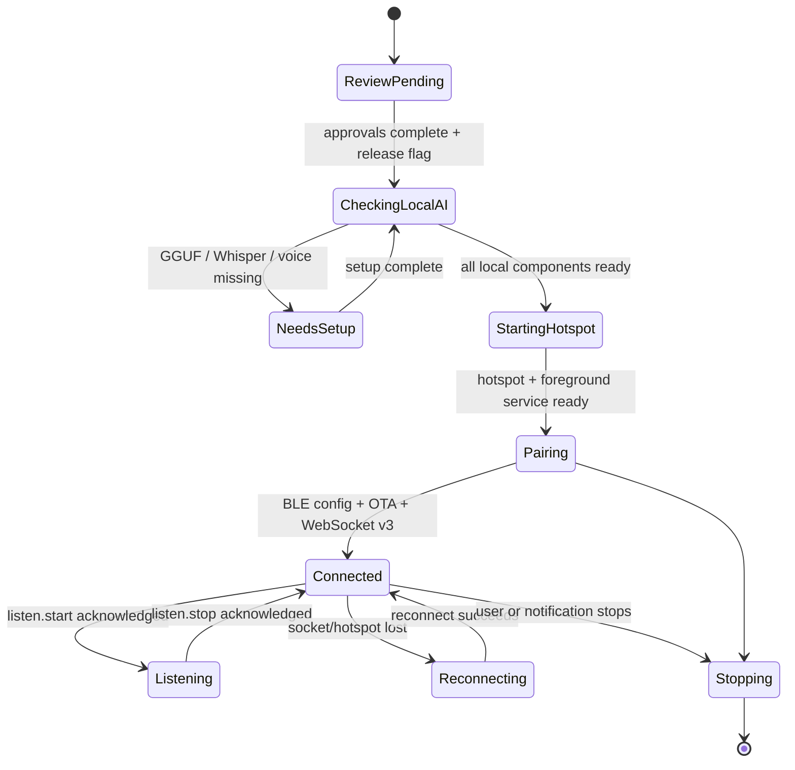

# Diagrams — NABI_ESP_ASSISTANT

The proposed BLE/AI/WebSocket sequence is in [Overall.md](../Overall.md#3-luồng-đề-xuất). The following state diagram is the release target, not current runtime behavior.

Current source stops at `ReviewPending`; no transition into network or AI session is implemented.
