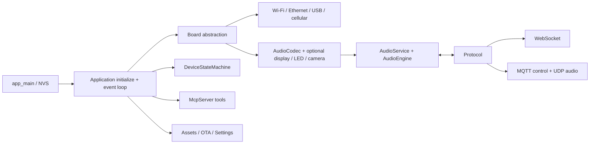

# Kiến trúc và luồng runtime

XiaoZhi là firmware trợ lý giọng nói chạy trên ESP-IDF. Firmware cung cấp phần chạy trên thiết bị; máy chủ AI và dịch vụ tài khoản/OTA nằm ngoài repository này. Mỗi lần build chọn đúng một board implementation, dù các module ứng dụng dùng chung cho nhiều chip ESP32.

## Khởi động và điều phối ứng dụng

`main/main.cc` là `app_main`: khởi tạo NVS, xử lý trường hợp NVS cần erase/re-init, rồi gọi `Application::Initialize()` và `Application::Run()`. `Application` trong `main/application.*` kết nối board, audio, display, settings, assets, MCP, OTA và protocol. `Run()` là vòng lặp điều phối chính; sự kiện mạng, audio, wake word, nút và timer được chuyển thành event bits hoặc callback đã schedule.

`DeviceStateMachine` trong `main/device_state_machine.*` là nơi xác nhận các chuyển trạng thái hợp lệ. Mã khác yêu cầu đổi trạng thái qua `Application::SetDeviceState()`. Callback có thể chạy ngoài task chính: dùng `Application::Schedule()` hoặc event bits cho thay đổi trạng thái ứng dụng; không chặn event loop hay task audio.

Luồng khái quát:

## Trừu tượng phần cứng và quyền sở hữu board

`main/boards/common/board.h` defines the `Board` contract: board identity, audio codec, network, power-save control, status/system information, and optional display, camera, battery, temperature, LED, or backlight capabilities. Default implementations allow optional hardware to be absent. `DECLARE_BOARD(BoardClass)` exports the selected board factory; a build must provide exactly one implementation.

`main/boards/common/` owns reusable hardware and connectivity helpers such as Wi-Fi, cellular, Ethernet, RNDIS, buttons, I2C devices, power timers, battery monitors, camera wrappers, and reset/power support. `main/boards/<vendor-or-board>/` owns concrete pins, drivers, board initialization, and board-specific controls. Core application code uses `Board` interfaces and must not include a concrete board class or board `config.h`.

## Pipeline audio

`AudioService` (`main/audio/audio_service.*`) owns separate input, output, and codec work. Microphone PCM flows through an `AudioEngine`, bounded encode work, Opus encoding, then a send queue consumed by `Protocol`. Incoming Opus packets flow through a bounded decode queue, Opus decode, and playback output to the codec. Queue definitions and task interfaces are in `audio_service.h` and `fixed_queue.h`.

`AudioEngine` is the common interface. `afe_audio_engine.*` uses ESP-SR AFE processing; `lite_audio_engine.*` is the lighter path. Wake-word adapters live under `audio/wake_words/`. Codec implementations under `audio/codecs/` bridge board-selected I2S/codec hardware. `ogg_demuxer.*` supports framed Ogg/Opus media such as notification audio. The audio README and codec-input audit document design constraints and board-specific input exceptions.

Audio changes must consider capture, playback, wake/VAD, interruption, reconnect, AEC mode, queue bounds, and target resources. Do not introduce unbounded queues or repeated large allocations in real-time tasks. Device AEC and server AEC are mutually exclusive Kconfig choices.

## Protocol và MCP

`Protocol` (`main/protocols/protocol.*`) owns transport-neutral message semantics, callbacks, shared audio packet types, and common outgoing message helpers. `WebsocketProtocol` carries JSON text and binary audio on its socket. `MqttProtocol` carries control JSON over MQTT and audio packets over encrypted UDP. Shared contract changes belong in `Protocol` where appropriate and must be checked against both transports. Protocol details are in `docs/websocket.md`, `docs/mqtt-udp.md`, and `docs/glyph-push.md`.

`McpServer` (`main/mcp_server.*`) parses device-side MCP JSON-RPC and dispatches registered tools. Common device tools and privileged/user-only tools are registered separately; boards can add their own tools. Preserve `cJSON` ownership and validate untrusted network data. See `docs/mcp-protocol.md` for the wire flow and `docs/mcp-usage.md` for registration examples.

## UI, assets, settings và cập nhật

`Display` is an optional interface. Implementations include LCD/OLED, E-paper, and LVGL; `NoDisplay` and default no-op methods represent unsupported capabilities. Theme, emoji, image, and dynamic glyph logic is under `main/display/lvgl_display/`. LED implementations are in `main/led/`. Voice notification playback is in `main/notify/` and is coordinated with `Application` and `AudioService`.

`Assets` loads the optional `assets` flash partition and exposes models, fonts, themes, images, and text-font capabilities. Default asset construction is selected through `main/CMakeLists.txt` and `scripts/build_default_assets.py`. `main/assets/lang_config.h` is generated by the language build flow; do not edit it by hand. Locale source data and localized Ogg prompts live under `main/assets/locales/`; shared tones live under `main/assets/common/`.

`Settings` persists device configuration in NVS; NVS key names are persistent API. `Ota` and the application version/asset checks handle updates, while `SystemInfo` reports device/build information. Board type and release variant identity affect firmware/OTA compatibility.

## Thành phần build

The root CMake project loads ESP-IDF; `main/CMakeLists.txt` selects common sources, one board directory, fonts/emojis, language resources, and asset generation based on Kconfig. `main/Kconfig.projbuild` declares board and feature choices. `scripts/build.py` is the canonical entry point that maps board config and release variant into an ESP-IDF build. The coupled selection chain and partition safety are described in [`BOARDS_AND_BUILD.md`](BOARDS_AND_BUILD.md).
