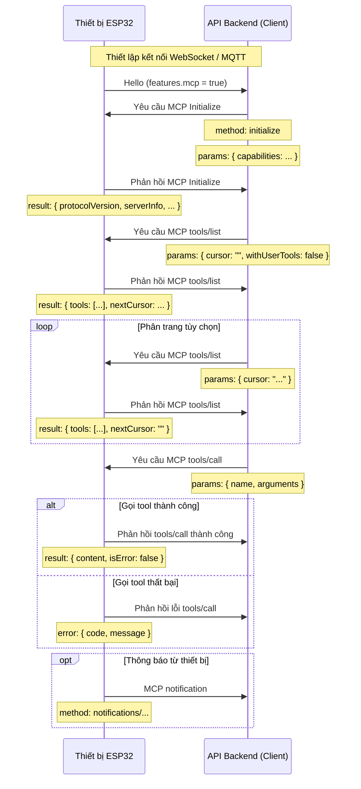

# Luồng tương tác MCP (Model Context Protocol)

**Lưu ý:** Tài liệu có sử dụng AI hỗ trợ biên soạn; khi triển khai backend, luôn đối chiếu chi tiết với mã nguồn.

Trong dự án này, MCP được dùng giữa API backend (MCP client) và thiết bị ESP32 (MCP server), để backend khám phá và gọi các chức năng (tool) mà thiết bị cung cấp.

## Định dạng thông điệp

Theo `main/protocols/protocol.cc` và `main/mcp_server.cc`, thông điệp MCP được bọc trong giao thức truyền tải bên dưới (WebSocket hoặc MQTT). Payload bên trong tuân theo đặc tả [JSON-RPC 2.0](https://www.jsonrpc.org/specification).

Cấu trúc tổng quát của thông điệp:

```json
{
  "session_id": "...",   // mã phiên
  "type": "mcp",         // giá trị cố định "mcp"
  "payload": {           // payload JSON-RPC 2.0
    "jsonrpc": "2.0",
    "method": "...",     // tên phương thức ("initialize", "tools/list", "tools/call", ...)
    "params": { ... },   // tham số (trong yêu cầu)
    "id": ...,           // mã yêu cầu (trong yêu cầu và phản hồi)
    "result": { ... },   // kết quả thành công (phản hồi)
    "error": { ... }     // thông tin lỗi (phản hồi)
  }
}
```

`payload` tuân theo JSON-RPC 2.0 tiêu chuẩn:

- `jsonrpc`: luôn là `"2.0"`.
- `method`: tên phương thức (trong yêu cầu).
- `params`: tham số có cấu trúc, thường là một object (trong yêu cầu).
- `id`: mã định danh yêu cầu; được gửi lại trong phản hồi.
- `result`: giá trị thành công (trong phản hồi).
- `error`: thông tin lỗi (trong phản hồi).

## Luồng tương tác

Client (backend) điều khiển các tương tác MCP bằng cách khám phá và gọi tool trên thiết bị.

1. **Kết nối và thông báo khả năng**

   - **Thời điểm**: sau khi thiết bị khởi động và kết nối với backend.
   - **Chiều truyền**: thiết bị -> backend.
   - **Thông điệp**: thiết bị gửi hello của giao thức truyền tải để công bố các khả năng hỗ trợ. MCP được báo hiệu bằng `"mcp": true` trong map `features`.
   - **Ví dụ (hello của giao thức truyền tải, không phải payload MCP):**
     ```json
     {
       "type": "hello",
       "version": 1,
       "features": {
         "mcp": true
       },
       "transport": "websocket",
       "audio_params": { ... },
       "session_id": "..."
     }
     ```

2. **Khởi tạo phiên MCP**

   - **Thời điểm**: sau khi backend xác nhận thiết bị hỗ trợ MCP. Đây thường là yêu cầu MCP đầu tiên.
   - **Chiều truyền**: backend -> thiết bị.
   - **Phương thức**: `initialize`
   - **Thông điệp (payload MCP):**
     ```json
     {
       "jsonrpc": "2.0",
       "method": "initialize",
       "params": {
         "capabilities": {
           // khả năng tùy chọn của client
           "vision": {
             "url": "...",   // endpoint tải ảnh camera lên (phải là URL http, không phải URL websocket)
             "token": "..."  // token cho URL tải lên
           }
           // ... các khả năng khác của client
         }
       },
       "id": 1
     }
     ```

   - **Phản hồi từ thiết bị:**
     ```json
     {
       "jsonrpc": "2.0",
       "id": 1,
       "result": {
         "protocolVersion": "2024-11-05",
         "capabilities": {
           "tools": {}
         },
         "serverInfo": {
           "name": "...",    // tên thiết bị (BOARD_NAME)
           "version": "..."  // phiên bản firmware
         }
       }
     }
     ```

3. **Khám phá danh sách tool**

   - **Thời điểm**: bất cứ khi nào backend cần danh sách tool có thể gọi cùng chữ ký của chúng.
   - **Chiều truyền**: backend -> thiết bị.
   - **Phương thức**: `tools/list`
   - **Tham số yêu cầu**:
     - `cursor` (string, tùy chọn): con trỏ phân trang; để trống trong yêu cầu đầu tiên.
     - `withUserTools` (boolean, tùy chọn, mặc định `false`): nếu `true`, thiết bị đưa thêm các tool “chỉ dành cho người dùng” vào danh sách (xem phần bên dưới). Tùy chọn này thường được ứng dụng đồng hành dùng để cho phép người dùng trực tiếp kích hoạt thao tác có đặc quyền.
   - **Thông điệp (payload MCP):**
     ```json
     {
       "jsonrpc": "2.0",
       "method": "tools/list",
       "params": {
         "cursor": "",
         "withUserTools": false
       },
       "id": 2
     }
     ```
   - **Phản hồi từ thiết bị:**
     ```json
     {
       "jsonrpc": "2.0",
       "id": 2,
       "result": {
         "tools": [
           {
             "name": "self.get_device_status",
             "description": "...",
             "inputSchema": { ... }
           },
           {
             "name": "self.audio_speaker.set_volume",
             "description": "...",
             "inputSchema": { ... }
           }
           // ... các tool khác
         ],
         "nextCursor": "..."
       }
     }
     ```
   - **Phân trang**: nếu `nextCursor` không rỗng, backend phải gửi yêu cầu `tools/list` khác kèm con trỏ đó để lấy trang kế tiếp.

4. **Gọi một tool**

   - **Thời điểm**: khi backend muốn thực thi một chức năng cụ thể trên thiết bị.
   - **Chiều truyền**: backend -> thiết bị.
   - **Phương thức**: `tools/call`
   - **Thông điệp (payload MCP):**
     ```json
     {
       "jsonrpc": "2.0",
       "method": "tools/call",
       "params": {
         "name": "self.audio_speaker.set_volume",
         "arguments": {
           "volume": 50
         }
       },
       "id": 3
     }
     ```
   - **Phản hồi thành công:**
     ```json
     {
       "jsonrpc": "2.0",
       "id": 3,
       "result": {
         "content": [
           { "type": "text", "text": "true" }
         ],
         "isError": false
       }
     }
     ```
   - **Phản hồi lỗi:**
     ```json
     {
       "jsonrpc": "2.0",
       "id": 3,
       "error": {
         "code": -32601,
         "message": "Unknown tool: self.non_existent_tool"
       }
     }
     ```

5. **Thông báo do thiết bị khởi tạo**

   - **Thời điểm**: khi thiết bị cần báo cho backend về sự kiện nội bộ (ví dụ chuyển trạng thái). `Application::SendMcpMessage` là điểm đầu vào để gửi đi.
   - **Chiều truyền**: thiết bị -> backend.
   - **Phương thức**: theo quy ước bắt đầu bằng `notifications/...` hoặc là phương thức tùy chỉnh bất kỳ.
   - **Thông điệp (payload MCP)**: notification theo JSON-RPC không có trường `id`.
     ```json
     {
       "jsonrpc": "2.0",
       "method": "notifications/state_changed",
       "params": {
         "newState": "idle",
         "oldState": "connecting"
       }
     }
     ```
   - **Xử lý phía backend**: xử lý notification mà không gửi phản hồi.

## Tool chỉ dành cho người dùng

MCP server trên thiết bị duy trì hai loại tool:

- **Tool thông thường** - đăng ký qua `McpServer::AddTool`. Mặc định, chúng hiển thị với backend (và do đó với model AI).
- **Tool chỉ dành cho người dùng** - đăng ký qua `McpServer::AddUserOnlyTool`. Chúng bị ẩn khỏi kết quả `tools/list` thông thường vì là thao tác có đặc quyền hoặc hướng tới người dùng, không nên để AI tự gọi. Ví dụ: khởi động lại hệ thống, nâng cấp firmware và tải ảnh chụp màn hình lên.

Backend bật quyền xem các tool này bằng cách gửi `tools/list` với `params.withUserTools = true`. Cách dùng điển hình là màn hình ứng dụng đồng hành cho phép người dùng cuối gọi những thao tác này.

Xem [Cách dùng MCP để điều khiển IoT](./mcp-usage_vi.md) để biết cách đăng ký từng loại tool ở phía thiết bị.

## Sơ đồ tuần tự

Sơ đồ đơn giản hóa luồng thông điệp MCP chính:



Tài liệu này tóm tắt luồng tương tác MCP trong dự án. Để biết chính xác hình dạng tham số, hành vi và tool hiện có, hãy tham khảo `McpServer::AddCommonTools` / `AddUserOnlyTools` trong `main/mcp_server.cc` cùng các hàm `InitializeTools` của từng bo.

