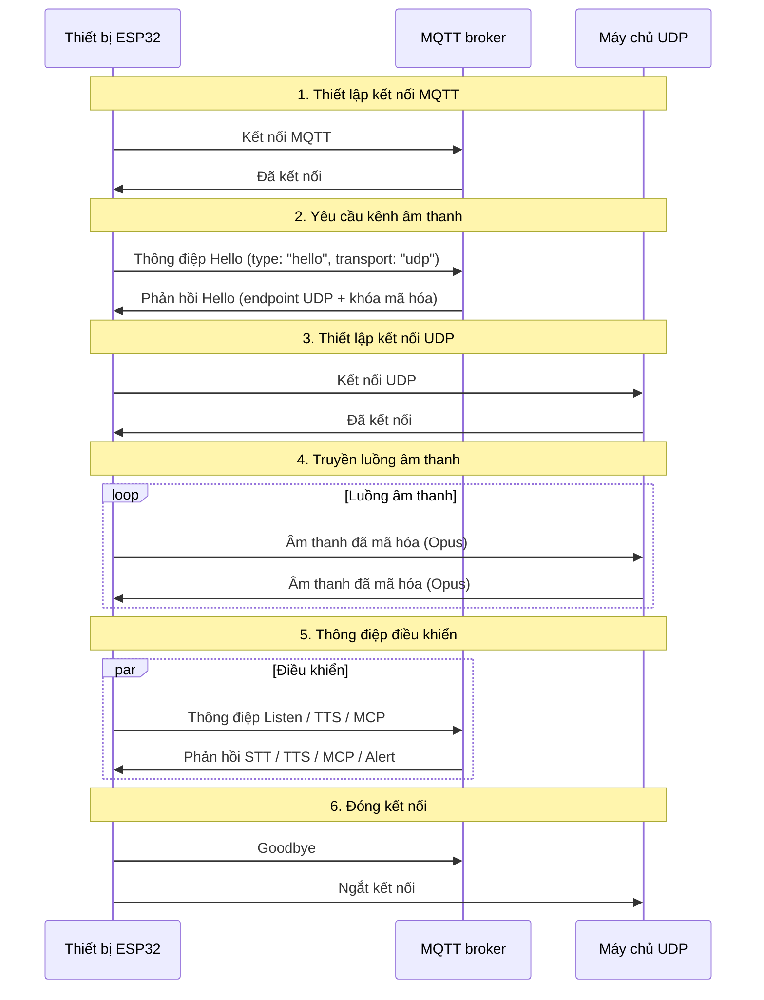
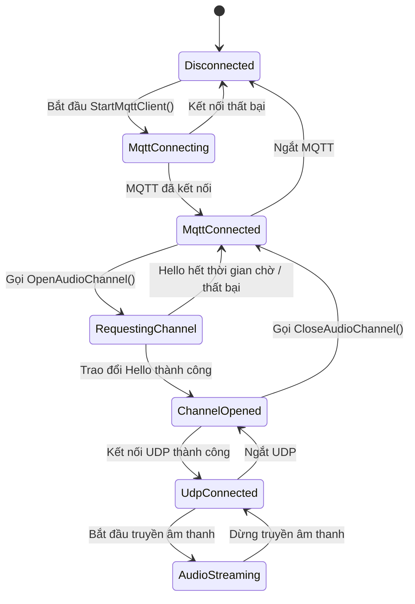

# Giao thức truyền thông kết hợp MQTT + UDP

Tài liệu này mô tả giao thức MQTT + UDP kết hợp mà thiết bị và máy chủ đang dùng theo triển khai hiện tại: MQTT truyền thông điệp điều khiển, còn UDP truyền âm thanh thời gian thực.

---

## 1. Tổng quan

Giao thức dùng hai kênh:

- **MQTT** - thông điệp điều khiển, đồng bộ trạng thái và payload JSON.
- **UDP** - âm thanh thời gian thực, được mã hóa.

### 1.1 Đặc điểm chính

- **Thiết kế hai kênh** - tách kênh điều khiển và dữ liệu để giảm độ trễ âm thanh.
- **Truyền tải được mã hóa** - âm thanh UDP được mã hóa bằng AES-CTR.
- **Số thứ tự** - bảo vệ khỏi phát lại và thay đổi thứ tự gói tin.
- **Tự động kết nối lại** - MQTT kết nối lại khi bị ngắt.

---

## 2. Luồng từ đầu đến cuối



## 3. Kênh điều khiển MQTT

### 3.1 Kết nối

Thiết bị kết nối với broker bằng các thông tin sau:

- **Endpoint** - máy chủ và cổng của broker.
- **Client ID** - mã định danh thiết bị.
- **Username / Password** - thông tin xác thực.
- **Keep Alive** - khoảng thời gian heartbeat (mặc định 240 giây).

### 3.2 Trao đổi Hello

#### 3.2.1 Thiết bị -> Máy chủ

```json
{
  "type": "hello",
  "version": 3,
  "transport": "udp",
  "features": {
    "mcp": true,
    "aec": true,
    "glyph_push": true
  },
  "text_font": {
    "bundle": "noto-v1",
    "charset": "common",
    "size": 20,
    "bpp": 4
  },
  "audio_params": {
    "format": "opus",
    "sample_rate": 16000,
    "channels": 1,
    "frame_duration": 60
  }
}
```

`features.mcp` luôn được đặt; `features.aec` được đặt khi bật `CONFIG_USE_SERVER_AEC`. `features.glyph_push` và `text_font` quảng bá phần mở rộng glyph văn bản động dùng chung, được mô tả trong [Phần mở rộng đẩy glyph văn bản động](glyph-push_vi.md).

#### 3.2.2 Máy chủ -> Thiết bị

```json
{
  "type": "hello",
  "transport": "udp",
  "session_id": "xxx",
  "audio_params": {
    "format": "opus",
    "sample_rate": 24000,
    "channels": 1,
    "frame_duration": 60
  },
  "udp": {
    "server": "192.168.1.100",
    "port": 8888,
    "key": "0123456789ABCDEF0123456789ABCDEF",
    "nonce": "0123456789ABCDEF0123456789ABCDEF"
  }
}
```

Tham chiếu trường:
- `udp.server` - địa chỉ máy chủ UDP.
- `udp.port` - cổng máy chủ UDP.
- `udp.key` - khóa AES, được mã hóa dạng hex.
- `udp.nonce` - nonce AES, được mã hóa dạng hex.

### 3.3 Các loại thông điệp JSON

#### 3.3.1 Thiết bị -> Máy chủ

1. **Listen**
   ```json
   {
     "session_id": "xxx",
     "type": "listen",
     "state": "start",
     "mode": "manual"
   }
   ```

2. **Abort**
   ```json
   {
     "session_id": "xxx",
     "type": "abort",
     "reason": "wake_word_detected"
   }
   ```

3. **MCP**
   ```json
   {
     "session_id": "xxx",
     "type": "mcp",
     "payload": {
       "jsonrpc": "2.0",
       "id": 1,
       "result": {}
     }
   }
   ```

4. **Goodbye**
   ```json
   {
     "session_id": "xxx",
     "type": "goodbye"
   }
   ```

#### 3.3.2 Máy chủ -> Thiết bị

Ngữ nghĩa tương ứng với giao thức WebSocket. Các loại được hỗ trợ:

- **STT** - kết quả nhận dạng giọng nói.
- **TTS** - vòng đời TTS (`start`, `stop`, `sentence_start`).
- **LLM** - cập nhật cảm xúc cho giao diện.
- **MCP** - điều khiển IoT.
- **System** - điều khiển hệ thống, ví dụ `"command": "reboot"`.
- **Alert** - hiển thị cảnh báo trên giao diện; các trường gồm `status`, `message`, `emotion`.
- **Goodbye** - máy chủ chủ động kết thúc phiên âm thanh. Thiết bị đóng kênh UDP mà không gửi goodbye của chính nó.
- **Custom** (tùy chọn, bật qua `CONFIG_RECEIVE_CUSTOM_MESSAGE`).

Ví dụ alert:

```json
{
  "session_id": "xxx",
  "type": "alert",
  "status": "Warning",
  "message": "Battery low",
  "emotion": "sad"
}
```

## 4. Kênh âm thanh UDP

### 4.1 Thiết lập kênh

Sau khi nhận phản hồi hello qua MQTT, thiết bị:

1. Phân tích máy chủ và cổng UDP.
2. Phân tích khóa AES và nonce.
3. Khởi tạo ngữ cảnh AES-CTR.
4. Mở socket UDP.

### 4.2 Định dạng gói âm thanh

#### 4.2.1 Gói âm thanh đã mã hóa

```text
|type 1B|flags 1B|payload_len 2B|ssrc 4B|timestamp 4B|sequence 4B|
|payload payload_len bytes|
```

Tham chiếu trường:
- `type`: loại gói, luôn là `0x01`.
- `flags`: cờ, hiện chưa dùng.
- `payload_len`: độ dài payload (thứ tự byte mạng).
- `ssrc`: mã định danh nguồn đồng bộ.
- `timestamp`: dấu thời gian (thứ tự byte mạng).
- `sequence`: số thứ tự (thứ tự byte mạng).
- `payload`: dữ liệu âm thanh Opus đã mã hóa.

#### 4.2.2 Mã hóa

Dùng **AES-CTR** với:

- **Khóa**: 128 bit, do máy chủ cung cấp.
- **Nonce**: 128 bit, do máy chủ cung cấp.
- **Bộ đếm**: tạo từ dấu thời gian và số thứ tự.

### 4.3 Quản lý số thứ tự

- **Bên gửi**: `local_sequence_` tăng đơn điệu.
- **Bên nhận**: `remote_sequence_` dùng để kiểm tra tính liên tục.
- **Chống phát lại**: gói có số thứ tự thấp hơn giá trị mong đợi sẽ bị loại.
- **Dung sai**: khoảng nhảy nhỏ được ghi cảnh báo nhưng gói vẫn được chấp nhận.

### 4.4 Xử lý lỗi

1. **Giải mã thất bại** - ghi lỗi và loại gói.
2. **Thiếu số thứ tự** - ghi cảnh báo, tiếp tục xử lý gói.
3. **Gói sai định dạng** - ghi lỗi và loại gói.

---

## 5. Quản lý trạng thái

### 5.1 Trạng thái kết nối



### 5.2 Kiểm tra trạng thái

Thiết bị xác định kênh âm thanh khả dụng bằng điều kiện sau:

```cpp
bool IsAudioChannelOpened() const {
    return udp_ != nullptr && !error_occurred_ && !IsTimeout();
}
```

## 6. Tham số cấu hình

### 6.1 Cấu hình MQTT

Đọc từ nơi lưu trữ:

- `endpoint` - địa chỉ broker.
- `client_id` - mã định danh client.
- `username` - tên người dùng.
- `password` - mật khẩu.
- `keepalive` - chu kỳ keep-alive (mặc định 240 giây).
- `publish_topic` - topic publish.

### 6.2 Tham số âm thanh

- **Định dạng**: Opus
- **Tần số lấy mẫu**: thiết bị 16 kHz / máy chủ 24 kHz
- **Số kênh**: 1 (mono)
- **Thời lượng frame**: 60 ms

## 7. Xử lý lỗi và kết nối lại

### 7.1 Kết nối lại MQTT

- Tự động thử lại khi kết nối thất bại.
- Có thể bật báo cáo lỗi.
- Chạy dọn dẹp khi ngắt kết nối.

### 7.2 Kết nối UDP

- Không tự động thử lại; phụ thuộc vào việc thương lượng lại qua MQTT.
- Có thể truy vấn trạng thái bất cứ lúc nào.

### 7.3 Hết thời gian chờ

Lớp cơ sở `Protocol` cung cấp khả năng phát hiện timeout:

- Timeout mặc định: 120 giây.
- Dựa trên thời gian kể từ gói tin đến gần nhất.
- Sau timeout, kênh được đánh dấu là không khả dụng.

## 8. Bảo mật

### 8.1 Mã hóa truyền tải

- **MQTT**: hỗ trợ TLS/SSL (cổng 8883).
- **UDP**: mã hóa payload âm thanh bằng AES-CTR.

### 8.2 Xác thực

- **MQTT**: tên người dùng / mật khẩu.
- **UDP**: khóa được phân phối qua kênh MQTT.

### 8.3 Chống phát lại

- Số thứ tự tăng đơn điệu.
- Gói cũ bị loại.
- Dấu thời gian được kiểm tra.

## 9. Ghi chú hiệu năng

### 9.1 Đồng bộ

Mutex bảo vệ kết nối UDP:

```cpp
std::lock_guard<std::mutex> lock(channel_mutex_);
```

### 9.2 Quản lý bộ nhớ

- Đối tượng mạng được tạo và hủy động.
- Gói âm thanh được quản lý bằng smart pointer.
- Giải phóng kịp thời các ngữ cảnh mã hóa.

### 9.3 Tối ưu mạng

- Tái sử dụng kết nối UDP.
- Dùng kích thước gói hợp lý.
- Kiểm tra tính liên tục của số thứ tự.

## 10. So sánh với WebSocket

| Tính năng | MQTT + UDP | WebSocket |
|---------|------------|-----------|
| Kênh điều khiển | MQTT | WebSocket |
| Kênh âm thanh | UDP (đã mã hóa) | WebSocket (binary) |
| Độ trễ | Thấp (UDP) | Trung bình |
| Độ tin cậy | Trung bình | Cao |
| Độ phức tạp | Cao | Thấp |
| Mã hóa | AES-CTR | TLS |
| Thân thiện với firewall | Thấp | Cao |

## 11. Ghi chú triển khai

### 11.1 Mạng

- Bảo đảm các cổng UDP có thể truy cập.
- Cấu hình quy tắc firewall phù hợp.
- Lập kế hoạch xử lý NAT traversal nếu cần.

### 11.2 Hạ tầng máy chủ

- Cấu hình MQTT broker.
- Triển khai máy chủ UDP.
- Quản lý khóa.

### 11.3 Giám sát

- Tỷ lệ kết nối thành công.
- Độ trễ truyền âm thanh.
- Mất gói.
- Lỗi giải mã.

## 12. Tóm tắt

Giao thức MQTT + UDP kết hợp truyền âm thanh hiệu quả nhờ:

- **Kiến trúc tách kênh** - chia kênh điều khiển và dữ liệu với trách nhiệm rõ ràng.
- **Mã hóa** - AES-CTR bảo vệ payload âm thanh.
- **Quản lý số thứ tự** - ngăn phát lại và đảo thứ tự gói.
- **Tự phục hồi** - MQTT kết nối lại khi có lỗi.
- **Hiệu năng** - UDP giữ độ trễ âm thanh thấp.

Giao thức phù hợp với tương tác giọng nói cần độ trễ thấp, đổi lại độ phức tạp mạng cao hơn so với chỉ dùng WebSocket.

