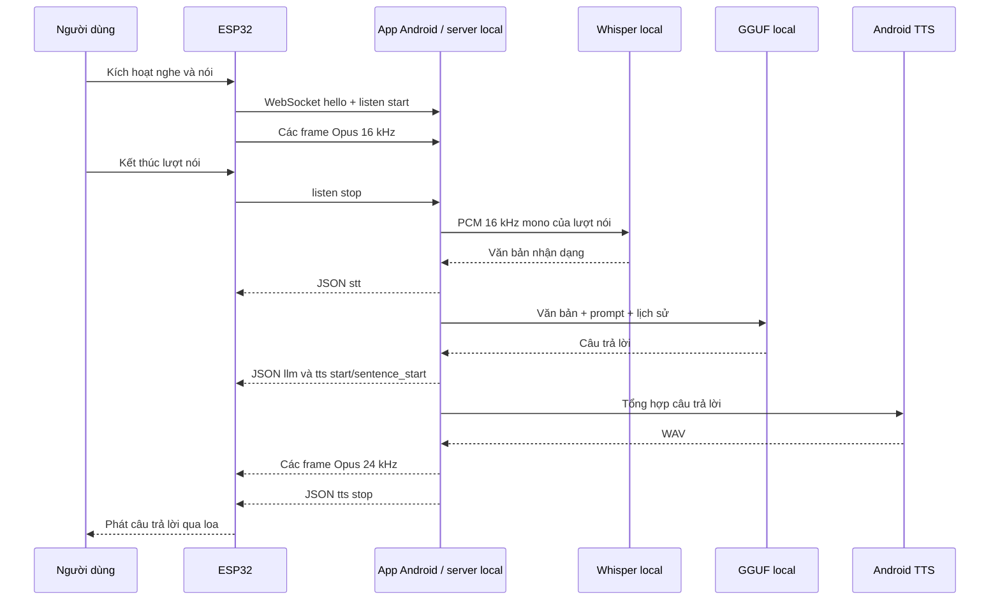

# Luồng AI local giữa XiaoZhi ESP32 và điện thoại Android

**Cập nhật đối chiếu mã nguồn:** 2026-10-23

**Phạm vi:** firmware XiaoZhi trong `iot/xiaozhi-esp32/` và ứng dụng Android trong `iot/xiaozhi-esp32/phone_app/`.

## 1. Tóm tắt kiến trúc

Điện thoại chạy một máy chủ XiaoZhi tương thích trong mạng nội bộ. ESP32 thu âm và gửi âm thanh Opus qua WebSocket. Ứng dụng điện thoại giải mã âm thanh, chạy Whisper để nhận dạng tiếng Việt, chạy model GGUF local để tạo câu trả lời, dùng Android Text-to-Speech để tạo giọng đọc, rồi gửi văn bản và audio Opus về ESP32.

Model không chạy trên ESP32. ESP32 không gọi dịch vụ AI cloud trong luồng này. HTTP OTA endpoint trên điện thoại chỉ giúp firmware lấy cấu hình kết nối WebSocket; suy luận AI diễn ra trong ứng dụng điện thoại.

Ứng dụng và firmware là hai phần độc lập của snapshot XiaoZhi, không phải một tích hợp với runtime Flutter chính của NanoBioAI.

## 2. Các thành phần và trách nhiệm

| Thành phần | Trách nhiệm trong luồng |
| --- | --- |
| Firmware ESP32 | Kết nối Wi-Fi, hỏi cấu hình OTA, mở WebSocket, gửi sự kiện nghe và audio Opus, phát audio nhận về. |
| Ứng dụng Android | Giữ model và Whisper, mở HTTP/WebSocket server trên cổng `8765`, điều phối STT → LLM → TTS. |
| Whisper local | Chuyển PCM từ audio ESP32 thành câu chữ. Cấu hình hiện dùng ngôn ngữ `vi`. |
| GGUF local | Sinh câu trả lời bằng ChatML trên điện thoại. |
| Android TTS | Tổng hợp câu trả lời thành WAV; ứng dụng đổi sang mono 24 kHz rồi mã hóa thành các gói Opus. |
| Wi-Fi LAN | Chuyển HTTP, WebSocket và audio giữa điện thoại với ESP32. Hai thiết bị phải liên lạc được qua cùng mạng. |

## 3. Luồng kết nối từ lúc khởi động

### 3.1 Chuẩn bị ứng dụng điện thoại

1. Cài hoặc nhập một model GGUF tương thích ChatML trong ứng dụng. Model tải từ Internet lần đầu; model sau khi có trên điện thoại có thể suy luận local.
2. Cài và nạp Whisper. Ứng dụng hiện dùng Whisper tiny Q5.
3. Chọn voice Android TTS. Nếu muốn hoạt động khi không có Internet, cần cài voice offline trên Android.
4. Kết nối điện thoại vào Wi-Fi dùng chung với ESP32 hoặc bật hotspot điện thoại rồi kết nối ESP32 vào đó.
5. Mở tab **ESP** và chọn **Khởi chạy server AI local**. Server chỉ khởi chạy khi cả LLM và Whisper đã nạp xong.

Khi khởi chạy, ứng dụng chọn một địa chỉ IPv4 của điện thoại, khởi tạo Opus và bind HTTP server vào `0.0.0.0:8765` để nhận kết nối qua các interface IPv4. Giao diện hiển thị địa chỉ nội bộ và OTA URL. Nếu giao diện chỉ ra `127.0.0.1`, địa chỉ đó chỉ dùng được trong chính điện thoại; ESP32 cần địa chỉ LAN có thể truy cập.

### 3.2 ESP32 lấy cấu hình WebSocket

Trong quá trình khởi tạo mạng, firmware gọi endpoint OTA đã cấu hình. Firmware có thể dùng HTTP GET hoặc POST tùy dữ liệu system-info; server của điện thoại định tuyến theo URL và không cần body để trả cấu hình.

OTA URL có dạng:

```text
http://<IP-điện-thoại>:8765/xiaozhi/ota/
```

Ứng dụng trả JSON có cấu trúc tương tự sau. Token là giá trị sinh riêng trên máy, không ghi token thật vào tài liệu hoặc log chia sẻ:

```json
{
  "websocket": {
    "url": "ws://<IP-điện-thoại>:8765/xiaozhi/v1/",
    "token": "<token-local-của-ứng-dụng>",
    "version": 3
  }
}
```

Firmware lưu các trường `url`, `token`, `version` vào cấu hình WebSocket trong NVS. Nếu phản hồi không yêu cầu cập nhật firmware, firmware chọn `WebsocketProtocol` vì phản hồi có đối tượng `websocket`. Endpoint này là **bootstrap cấu hình kết nối**; nó không phải endpoint suy luận AI và cũng không gửi firmware binary trong phản hồi hiện tại của ứng dụng.

### 3.3 Cấu hình OTA theo IP điện thoại

Firmware chọn OTA URL theo cấu hình build:

- Nếu `CONFIG_OTA_URL_IGNORE_NVS` bật, firmware luôn dùng URL compile-time trong `CONFIG_OTA_URL`.
- Nếu tùy chọn đó tắt, firmware ưu tiên OTA URL đã lưu trong NVS; khi NVS trống mới dùng URL mặc định từ build.

Profile OSTB XiaoZhi 3ST `config.local-ai.json` hiện đặt URL `192.168.11.145` và bật `CONFIG_OTA_URL_IGNORE_NVS`. Với profile này, thay đổi **Custom OTA URL** đã lưu trong NVS không có hiệu lực. Nếu IP điện thoại thay đổi, cần cập nhật profile và build lại, hoặc dùng build profile tôn trọng URL NVS rồi nhập OTA URL hiện tại trong trang cấu hình ESP.

Giữ nguyên phân vùng 16 MB của board OSTB 3ST khi build/flash. Không dùng cấu hình board này cho một board khác.

## 4. Bắt tay WebSocket

Khi cần mở audio channel, firmware đọc `url`, `token` và `version` đã nhận từ OTA, rồi kết nối tới WebSocket trên điện thoại. Handshake có các header:

```text
Authorization: Bearer <token>
Protocol-Version: 3
Device-Id: <MAC-của-ESP>
Client-Id: <UUID-của-board>
```

Ứng dụng từ chối WebSocket nếu Bearer token không khớp. Sau khi kết nối, ESP gửi JSON `hello` chứa protocol version và audio format. Với luồng hiện tại, audio từ ESP là Opus mono 16 kHz. Điện thoại trả `hello` xác nhận transport WebSocket và khai báo audio trả về mono 24 kHz, frame 60 ms. Firmware chờ server hello tối đa 10 giây.

Phiên bản binary protocol 3 đóng gói mỗi gói audio với header 4 byte: `type`, `reserved`, `payload_size` 16-bit big-endian, tiếp theo là payload Opus. Ứng dụng điện thoại và firmware hiện cùng xử lý định dạng này.

## 5. Luồng một lượt hội thoại

1. Người dùng kích hoạt nghe trên ESP32 bằng thao tác được board hỗ trợ, chẳng hạn nút hoặc wake word.
2. ESP mở audio channel nếu chưa có, gửi `listen` với `state: start`, rồi bắt đầu gửi các frame Opus nhị phân.
3. Điện thoại kiểm tra header version 3, lấy payload Opus và giải mã thành PCM 16 kHz mono. PCM của toàn bộ lượt nói được giữ lại trong bộ nhớ khi firmware đang ở trạng thái nghe.
4. Khi ESP gửi `listen` với `state: stop`, điện thoại đưa PCM đã gom vào Whisper. Whisper nhận mảng PCM float, dùng cấu hình tiếng Việt và trả văn bản nhận dạng.
5. Điện thoại gửi JSON `stt` chứa văn bản nhận dạng để firmware có thể hiển thị.
6. Ứng dụng đưa văn bản, system prompt, lịch sử hội thoại và cấu hình nhiệt độ vào model GGUF. Inference chạy trên điện thoại bằng ChatML; cấu hình hiện tại dùng tối đa 256 token đầu ra.
7. Ứng dụng gửi sự kiện `llm`, sau đó `tts` với trạng thái `start` và `sentence_start`; trường `text` chứa toàn bộ câu trả lời.
8. Android TTS tổng hợp câu trả lời thành WAV. Ứng dụng chuyển âm thanh thành mono 24 kHz, mã hóa Opus theo frame 60 ms và gửi các frame nhị phân version 3.
9. Ứng dụng gửi `tts` với trạng thái `stop`. Firmware kết thúc phát audio và trở về trạng thái chờ hoặc tiếp tục nghe theo chế độ hoạt động của nó.



## 6. Dữ liệu đi qua mạng và lưu trữ

- Audio microphone được truyền qua mạng LAN đến điện thoại; firmware không gửi audio lên AI cloud trong luồng này.
- Ứng dụng xử lý audio, văn bản nhận dạng và prompt trong bộ nhớ tiến trình để gọi Whisper và LLM local.
- Model GGUF và model Whisper được lưu trong vùng dữ liệu riêng của ứng dụng Android. Việc tải model lần đầu cần Internet; suy luận sau khi model đã sẵn sàng chạy trên điện thoại.
- Token WebSocket được lưu trong SharedPreferences của ứng dụng. OTA endpoint trả token cho thiết bị; WebSocket endpoint yêu cầu token đó.
- Endpoint hiện dùng HTTP và WebSocket thường (`http://`, `ws://`), chưa mã hóa TLS. Chỉ chạy trên mạng nội bộ đáng tin cậy; không chuyển tiếp cổng `8765` ra Internet hoặc mạng công cộng.
- Nếu Android TTS đang dùng voice phụ thuộc mạng, phần tổng hợp giọng nói vẫn có thể cần Internet dù LLM chạy local.

## 7. Giới hạn hiện tại

- Ứng dụng chưa đăng ký Android foreground service. Ứng dụng giữ màn hình bật khi server đang chạy, nhưng người dùng cần để app mở ở foreground để tránh hệ thống dừng server.
- Nhận dạng chỉ bắt đầu sau `listen stop`; LLM tạo xong câu trả lời trước khi TTS tổng hợp toàn bộ file WAV. Đây là hội thoại theo lượt, chưa phải streaming STT/LLM/TTS đầu-cuối.
- Âm thanh của một lượt được gom vào bộ nhớ trước khi Whisper chạy. Lượt nói quá dài làm tăng bộ nhớ và thời gian chờ.
- Lịch sử hội thoại hiện là một danh sách dùng chung trong server; chưa tách theo từng thiết bị. Nên nghiệm thu với một ESP32 trước. Muốn phục vụ nhiều ESP đồng thời cần tách session và điều phối tài nguyên model/TTS.
- IP điện thoại có thể đổi khi đổi Wi-Fi hoặc bật/tắt hotspot. Cần lấy OTA URL mới trong app và bảo đảm cấu hình firmware sử dụng đúng URL đó.

## 8. Kiểm tra và xử lý lỗi

| Triệu chứng | Kiểm tra |
| --- | --- |
| Không khởi chạy được server | Xác nhận LLM và Whisper đều báo sẵn sàng trong tab ESP; xem lỗi hiện trên app. |
| ESP không nhận được OTA config | Kiểm tra hai thiết bị cùng mạng, IP điện thoại, cổng `8765`, đường dẫn `/xiaozhi/ota/` và profile OTA đang chạy trên firmware. |
| Đổi Custom OTA URL nhưng ESP vẫn gọi IP cũ | Kiểm tra `CONFIG_OTA_URL_IGNORE_NVS`; profile local-ai OSTB hiện bật tùy chọn này. |
| WebSocket trả Unauthorized | Firmware đang dùng token cũ hoặc cấu hình WebSocket không lấy từ lần OTA hiện tại; khởi động lại quy trình cấu hình OTA và không chép token từ thiết bị khác. |
| Kết nối WebSocket hết thời gian chờ hello | Đảm bảo app vẫn mở, server đang chạy và IP/port có thể truy cập được từ ESP. |
| Nhận STT nhưng không nghe thấy câu trả lời | Kiểm tra trạng thái TTS, voice Android đã chọn, file WAV có được Android TTS tạo và luồng loa ESP hoạt động. |

### Checklist nghiệm thu MVP

1. Tab ESP báo model ngôn ngữ và Whisper sẵn sàng.
2. `/health` trên địa chỉ LAN trả `ok: true`, `llm: true`, `stt: true`.
3. ESP lấy được JSON OTA có URL WebSocket, token và version `3`.
4. ESP kết nối WebSocket, gửi `hello` và nhận `hello` từ app.
5. Thử một câu ngắn bằng micro ESP; xác nhận có `stt`, câu trả lời LLM và audio phát qua loa.
6. Sau khi model và voice đã cài, ngắt Internet nhưng giữ LAN; xác nhận hội thoại local vẫn chạy.
7. Để app về nền hoặc tắt màn hình trong một khoảng thời gian; ghi nhận rõ hành vi thực tế của Android và kết nối trước khi coi luồng always-on đã đạt.

Checklist trên là tiêu chí đề xuất. Tài liệu này chưa ghi nhận kết quả chạy trên thiết bị thật.

## 9. Source of truth trong repository

- [Hướng dẫn app và kết nối ESP](../phone_app/README.md)
- [Server HTTP/WebSocket của app](../phone_app/lib/services/xiaozhi_server.dart)
- [Suy luận GGUF và Whisper](../phone_app/lib/services/local_ai_service.dart)
- [Android TTS và mã hóa Opus](../phone_app/lib/services/voice_service.dart)
- [OTA firmware](../main/ota.cc)
- [Chọn protocol sau OTA](../main/application.cc)
- [WebSocket firmware](../main/protocols/websocket_protocol.cc)
- [Hồ sơ local AI cho OSTB 3ST](../main/boards/ostb/ostb-xiaozhi-3st/config.local-ai.json)
- [Hướng dẫn board OSTB 3ST](../main/boards/ostb/ostb-xiaozhi-3st/README.md)
