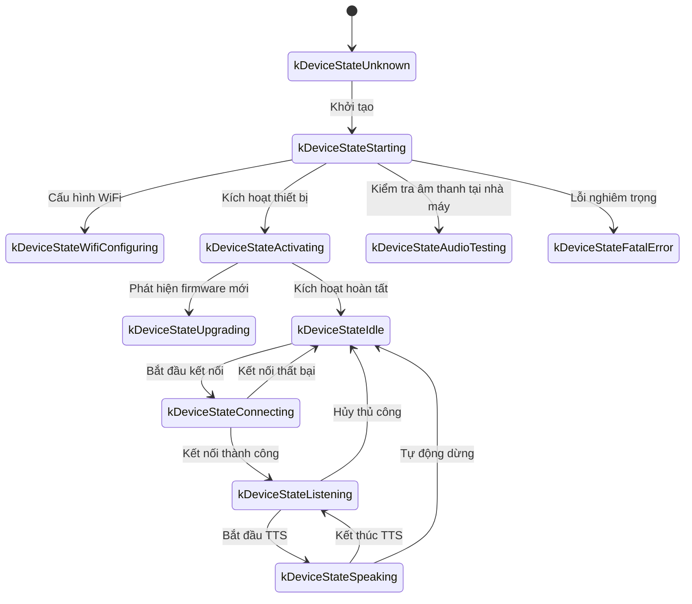
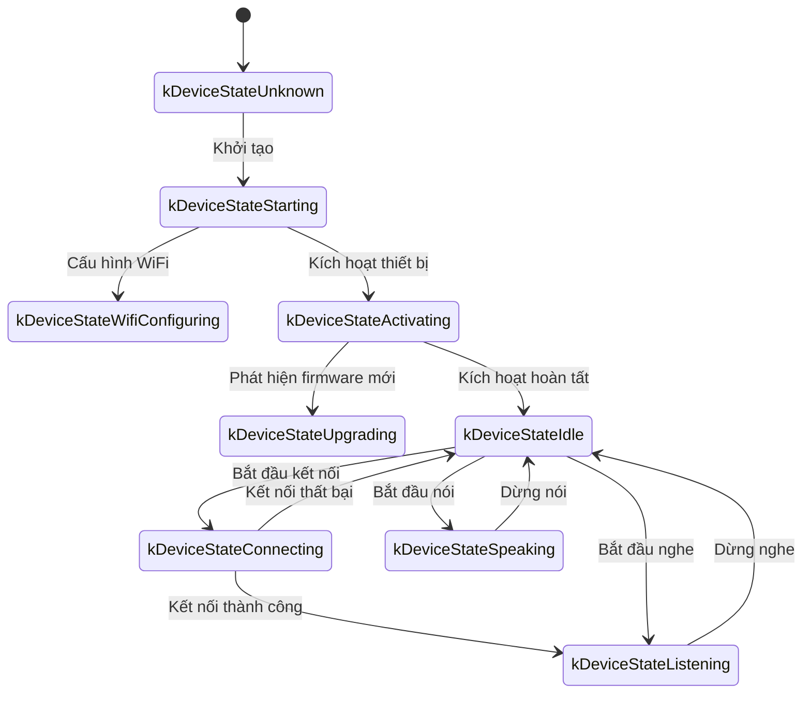

# Giao thức truyền thông WebSocket

Tài liệu này mô tả giao thức WebSocket giữa thiết bị và máy chủ dựa trên mã hiện tại. Khi triển khai máy chủ, hãy đối chiếu lại với phần triển khai thực tế.

---

## 1. Luồng tổng quát

1. **Khởi tạo thiết bị**
   - Khi khởi động, thiết bị khởi tạo `Application`:
     - Khởi tạo codec âm thanh, màn hình, LED, v.v.
     - Kết nối mạng.
     - Tạo một phiên bản giao thức WebSocket (`WebsocketProtocol`) triển khai interface `Protocol`.
   - Thiết bị vào vòng lặp chính và chờ sự kiện (đầu vào âm thanh, đầu ra âm thanh, tác vụ đã lên lịch, v.v.).

2. **Mở kết nối WebSocket**
   - Khi cần bắt đầu phiên giọng nói (đánh thức, nhấn nút, v.v.), thiết bị gọi `OpenAudioChannel()`:
     - Đọc URL WebSocket từ phần cài đặt.
     - Đặt các header yêu cầu (`Authorization`, `Protocol-Version`, `Device-Id`, `Client-Id`).
     - Gọi `Connect()` để thiết lập kết nối WebSocket.

3. **Thiết bị gửi thông điệp “hello”**
   - Sau khi kết nối, thiết bị gửi thông điệp JSON. Ví dụ:
   ```json
   {
     "type": "hello",
     "version": 1,
     "features": {
       "mcp": true,
       "aec": true,
       "glyph_push": true
     },
     "text_font": {
       "bundle": "noto-v1",
       "charset": "common",
       "size": 20,
       "bpp": 4
     },
     "transport": "websocket",
     "audio_params": {
       "format": "opus",
       "sample_rate": 16000,
       "channels": 1,
       "frame_duration": 60
     }
   }
   ```
   - `features` là tùy chọn và được tạo từ cấu hình lúc biên dịch. Ví dụ, `"mcp": true` nghĩa là thiết bị hỗ trợ MCP; `"aec": true` được gửi khi bật `CONFIG_USE_SERVER_AEC`.
   - `"glyph_push": true` và `text_font` quảng bá phần mở rộng glyph văn bản động tùy chọn. Xem [Phần mở rộng đẩy glyph văn bản động](glyph-push_vi.md).
   - `frame_duration` khớp với `OPUS_FRAME_DURATION_MS` (thường là 60 ms).

4. **Máy chủ phản hồi “hello”**
   - Thiết bị chờ thông điệp JSON có `"type"` là `"hello"` và `"transport"` là `"websocket"`.
   - Máy chủ có thể gửi `session_id`; thiết bị sẽ lưu giá trị này.
   - Ví dụ:
   ```json
   {
     "type": "hello",
     "transport": "websocket",
     "session_id": "xxx",
     "audio_params": {
       "format": "opus",
       "sample_rate": 24000,
       "channels": 1,
       "frame_duration": 60
     }
   }
   ```
   - Nếu `transport` khớp, thiết bị đánh dấu kênh âm thanh đã mở.
   - Nếu không nhận được hello hợp lệ trước timeout (mặc định 10 giây), kết nối được xem là thất bại và callback lỗi mạng được gọi.

5. **Các lượt trao đổi tiếp theo**
   - Hai loại dữ liệu được gửi theo cả hai chiều:
     1. **Dữ liệu âm thanh nhị phân** (mã hóa Opus)
     2. **Thông điệp JSON dạng text** (trạng thái chat, sự kiện TTS/STT, thông điệp MCP, v.v.)
   - Trong mã, callback nhận dữ liệu phân luồng như sau:
     - `OnData(...)`:
       - Nếu `binary` là `true`, payload được xem là frame Opus và giải mã.
       - Nếu `binary` là `false`, payload được phân tích thành JSON và phân phối theo `type`.
   - Khi máy chủ hoặc mạng bị ngắt, `OnDisconnected()` được gọi:
     - Thiết bị gọi `on_audio_channel_closed_()` và sau đó trở về trạng thái rảnh.

6. **Đóng kết nối WebSocket**
   - Khi muốn kết thúc phiên, thiết bị gọi `CloseAudioChannel()` để đóng socket rồi trở về trạng thái rảnh.
   - Chuỗi callback tương tự cũng chạy nếu máy chủ đóng socket trước.

---

## 2. Các header yêu cầu phổ biến

Khi thiết lập kết nối WebSocket, thiết bị đặt các header sau:

- `Authorization`: access token, thường có định dạng `"Bearer <token>"`.
- `Protocol-Version`: số phiên bản giao thức, khớp trường `version` trong thông điệp hello.
- `Device-Id`: địa chỉ MAC vật lý của thiết bị.
- `Client-Id`: UUID do phần mềm tạo (được đặt lại khi xóa NVS hoặc flash lại toàn bộ firmware).

Các header này được gửi cùng quá trình bắt tay WebSocket; máy chủ có thể dùng chúng để xác thực hoặc quản lý thiết bị.

---

## 3. Các phiên bản giao thức nhị phân

Thiết bị hỗ trợ một số phiên bản giao thức nhị phân, được chọn bằng trường `version` trong phần cài đặt:

### 3.1 Phiên bản 1 (mặc định)

Frame Opus thô, không có metadata bổ sung. Lớp WebSocket đã phân biệt frame text và binary.

### 3.2 Phiên bản 2

Dùng cấu trúc `BinaryProtocol2`:

```c
struct BinaryProtocol2 {
    uint16_t version;        // phiên bản giao thức
    uint16_t type;           // loại thông điệp (0: OPUS, 1: JSON)
    uint32_t reserved;       // trường dành riêng
    uint32_t timestamp;      // dấu thời gian theo mili giây (hữu ích cho AEC phía máy chủ)
    uint32_t payload_size;   // kích thước payload theo byte
    uint8_t payload[];       // payload
} __attribute__((packed));
```

### 3.3 Phiên bản 3

Dùng cấu trúc `BinaryProtocol3`:

```c
struct BinaryProtocol3 {
    uint8_t type;            // loại thông điệp
    uint8_t reserved;        // trường dành riêng
    uint16_t payload_size;   // kích thước payload
    uint8_t payload[];       // payload
} __attribute__((packed));
```

---

## 4. Cấu trúc thông điệp JSON

Các frame text của WebSocket mang JSON. Dưới đây là các giá trị `"type"` thường gặp và ý nghĩa tương ứng. Trường không liệt kê có thể dành riêng cho cách triển khai cụ thể hoặc là tùy chọn.

### 4.1 Thiết bị -> Máy chủ

1. **Hello**
   - Gửi một lần sau khi kết nối được thiết lập để thông báo các tham số thiết bị.
   - Ví dụ:
     ```json
     {
       "type": "hello",
       "version": 1,
       "features": {
         "mcp": true,
         "aec": true
       },
       "transport": "websocket",
       "audio_params": {
         "format": "opus",
         "sample_rate": 16000,
         "channels": 1,
         "frame_duration": 60
       }
     }
     ```

2. **Listen**
   - Báo cho máy chủ biết thiết bị bắt đầu hoặc dừng thu âm từ micro.
   - Các trường thường gặp:
     - `"session_id"`: mã phiên.
     - `"type": "listen"`
     - `"state"`: `"start"`, `"stop"` hoặc `"detect"` (đã phát hiện từ đánh thức).
     - `"mode"`: `"auto"`, `"manual"` hoặc `"realtime"`.
   - Ví dụ (bắt đầu nghe):
     ```json
     {
       "session_id": "xxx",
       "type": "listen",
       "state": "start",
       "mode": "manual"
     }
     ```

3. **Abort**
   - Hủy phát TTS hiện tại hoặc đóng kênh giọng nói.
   - Ví dụ:
     ```json
     {
       "session_id": "xxx",
       "type": "abort",
       "reason": "wake_word_detected"
     }
     ```
   - `reason` có thể là `"wake_word_detected"` hoặc giá trị khác tùy cách triển khai.

4. **Phát hiện từ đánh thức**
   - Thiết bị gửi thông điệp khi bộ phát hiện từ đánh thức cục bộ kích hoạt.
   - Có thể gửi trước âm thanh Opus chứa từ đánh thức để máy chủ xác minh giọng nói.
   - Ví dụ:
     ```json
     {
       "session_id": "xxx",
       "type": "listen",
       "state": "detect",
       "text": "Hi XiaoZhi"
     }
     ```

5. **MCP**
   - Đây là kênh được khuyến nghị cho điều khiển IoT. Việc khám phá khả năng thiết bị và gọi tool đều dùng thông điệp `type: "mcp"` có `payload` theo JSON-RPC 2.0 (xem [Tài liệu giao thức MCP](./mcp-protocol_vi.md)).
   - Ví dụ phản hồi từ thiết bị đến máy chủ:
     ```json
     {
       "session_id": "xxx",
       "type": "mcp",
       "payload": {
         "jsonrpc": "2.0",
         "id": 1,
         "result": {
           "content": [
             { "type": "text", "text": "true" }
           ],
           "isError": false
         }
       }
     }
     ```

---

### 4.2 Máy chủ -> Thiết bị

1. **Hello**
   - Xác nhận quá trình bắt tay.
   - Phải có `"type": "hello"` và `"transport": "websocket"`.
   - Có thể có `audio_params`, thể hiện tham số âm thanh máy chủ mong đợi hoặc bộ tham số chuẩn đã thống nhất với thiết bị.
   - Có thể có `session_id`; thiết bị sẽ ghi lại giá trị này.
   - Khi nhận được, thiết bị đặt sự kiện báo kênh âm thanh đã mở.

2. **STT**
   - `{"session_id": "xxx", "type": "stt", "text": "..."}`
   - Kết quả chuyển lời nói của người dùng thành văn bản. Thường văn bản được hiển thị trước khi chuyển sang phản hồi.

3. **LLM**
   - `{"session_id": "xxx", "type": "llm", "emotion": "happy", "text": "😀"}`
   - Yêu cầu thiết bị cập nhật cảm xúc / biểu cảm trên giao diện.

4. **TTS**
   - `{"session_id": "xxx", "type": "tts", "state": "start"}`: máy chủ sắp truyền âm thanh TTS; thiết bị chuyển sang trạng thái đang nói.
   - `{"session_id": "xxx", "type": "tts", "state": "stop"}`: đoạn TTS đã kết thúc.
   - `{"session_id": "xxx", "type": "tts", "state": "sentence_start", "text": "..."}`: hiển thị câu hiện tại trên giao diện (ví dụ dưới dạng phụ đề).

5. **MCP**
   - Máy chủ gửi lệnh điều khiển IoT hoặc nhận kết quả gọi tool. Cấu trúc `payload` tuân theo JSON-RPC 2.0.
   - Ví dụ gọi `tools/call` từ máy chủ đến thiết bị:
     ```json
     {
       "session_id": "xxx",
       "type": "mcp",
       "payload": {
         "jsonrpc": "2.0",
         "method": "tools/call",
         "params": {
           "name": "self.light.set_rgb",
           "arguments": { "r": 255, "g": 0, "b": 0 }
         },
         "id": 1
       }
     }
     ```

6. **System**
   - Điều khiển cấp hệ thống, thường dùng cho cập nhật / quản lý từ xa.
   - Ví dụ:
     ```json
     {
       "session_id": "xxx",
       "type": "system",
       "command": "reboot"
     }
     ```
   - Lệnh được hỗ trợ:
     - `"reboot"`: khởi động lại thiết bị.

7. **Alert**
   - Yêu cầu thiết bị hiển thị cảnh báo và phát âm thanh rung. Được xử lý trong `Application::OnIncomingJson`.
   - Ví dụ:
     ```json
     {
       "session_id": "xxx",
       "type": "alert",
       "status": "Warning",
       "message": "Battery low",
       "emotion": "sad"
     }
     ```
   - Các trường:
     - `status`: tiêu đề ngắn hiển thị trên màn hình.
     - `message`: thông báo chi tiết.
     - `emotion`: cảm xúc được hiển thị trong lúc cảnh báo (ví dụ `"sad"`, `"neutral"`).

8. **Custom** (tùy chọn)
   - Khả dụng khi bật `CONFIG_RECEIVE_CUSTOM_MESSAGE`.
   - Ví dụ:
     ```json
     {
       "session_id": "xxx",
       "type": "custom",
       "payload": {
         "message": "anything you want"
       }
     }
     ```

9. **Frame âm thanh nhị phân**
   - Khi máy chủ gửi âm thanh Opus dưới dạng frame nhị phân, thiết bị giải mã và phát.
   - Frame nhận được khi thiết bị ở trạng thái `listening` sẽ bị loại để tránh xung đột với luồng micro.

---

## 5. Codec âm thanh

1. **Thiết bị tải âm thanh micro lên**
   - Sau khi xử lý AEC / NR / AGC tùy chọn, âm thanh được mã hóa Opus và gửi dưới dạng frame nhị phân.
   - Tùy phiên bản giao thức, frame có thể là Opus thô (v1) hoặc được bọc trong cấu trúc metadata (v2/v3).

2. **Thiết bị phát âm thanh từ máy chủ**
   - Frame nhị phân nhận được cũng được xem là Opus.
   - Thiết bị giải mã rồi gửi dữ liệu đến đầu ra âm thanh.
   - Nếu tần số lấy mẫu khác đầu ra thiết bị, dữ liệu được resample sau khi giải mã.

---

## 6. Trạng thái thiết bị

### 6.1 Các trạng thái chính

State machine của thiết bị được định nghĩa trong [`main/device_state.h`](../main/device_state.h), gồm:

- `kDeviceStateUnknown`
- `kDeviceStateStarting`
- `kDeviceStateWifiConfiguring`
- `kDeviceStateIdle`
- `kDeviceStateConnecting`
- `kDeviceStateListening`
- `kDeviceStateSpeaking`
- `kDeviceStateUpgrading`
- `kDeviceStateActivating`
- `kDeviceStateAudioTesting` (kiểm tra âm thanh tại nhà máy / khi bring-up)
- `kDeviceStateFatalError` (lỗi không thể khôi phục, cần người dùng xử lý)

### 6.2 Các chuyển trạng thái thường gặp

1. **Idle -> Connecting**
   - Được kích hoạt bằng từ đánh thức hoặc nhấn nút. Thiết bị gọi `OpenAudioChannel()`, thiết lập WebSocket và gửi `"type":"hello"`.

2. **Connecting -> Listening**
   - Sau khi kết nối, gọi `SendStartListening(...)` và bắt đầu truyền âm thanh micro.

3. **Listening -> Speaking**
   - Máy chủ gửi `{"type":"tts","state":"start"}`; thiết bị dừng gửi âm thanh micro và phát TTS nhận được.

4. **Speaking -> Idle**
   - Máy chủ gửi `{"type":"tts","state":"stop"}`. Khi bật tiếp tục tự động, thiết bị quay lại Listening; nếu không, thiết bị trở về Idle.

5. **Listening / Speaking -> Idle** (hủy)
   - `SendAbortSpeaking(...)` hoặc `CloseAudioChannel()` ngắt phiên và đóng WebSocket.

### 6.3 Sơ đồ trạng thái chế độ tự động



### 6.4 Sơ đồ trạng thái chế độ thủ công



---

## 7. Xử lý lỗi

1. **Kết nối thất bại**
   - Nếu `Connect(url)` thất bại hoặc không nhận được hello từ máy chủ trước khi hết timeout, `on_network_error_()` được gọi và thiết bị hiển thị cảnh báo “không thể kết nối”.

2. **Máy chủ ngắt kết nối**
   - Nếu WebSocket bị rớt bất ngờ, `OnDisconnected()` được gọi:
     - Chạy `on_audio_channel_closed_()`.
     - Thiết bị trở về Idle (hoặc thử lại, tùy chính sách).

---

## 8. Ghi chú khác

1. **Xác thực**
   - Thiết bị gửi `Authorization: Bearer <token>`; máy chủ phải xác minh.
   - Nếu token không có hoặc không hợp lệ, máy chủ có thể từ chối bắt tay hoặc chấm dứt phiên sau đó.

2. **Phạm vi phiên**
   - Nhiều thông điệp mang `session_id`, hữu ích khi máy chủ phục vụ nhiều tương tác đồng thời.

3. **Payload âm thanh**
   - Định dạng mặc định là Opus 16 kHz, mono. Thời lượng frame do `OPUS_FRAME_DURATION_MS` điều khiển (thường là 60 ms). Máy chủ có thể dùng 24 kHz cho luồng xuống để phát nhạc tốt hơn.

4. **Chọn phiên bản giao thức nhị phân**
   - Cấu hình qua giá trị `version`:
     - v1: Opus thô
     - v2: metadata + dấu thời gian (hữu ích cho AEC phía máy chủ)
     - v3: header gọn nhẹ
   - Giá trị này được phản hồi trong header `Protocol-Version` và thông điệp hello.

5. **Điều khiển IoT bằng MCP**
   - Mọi thao tác khám phá khả năng IoT và điều khiển đều đi qua MCP (`type: "mcp"`). Giao thức cũ `type: "iot"` đã bị loại bỏ.
   - MCP hoạt động trên cả WebSocket và MQTT, giúp tăng tính chuẩn hóa và khả năng mở rộng.
   - Xem [Tài liệu giao thức MCP](./mcp-protocol_vi.md) và [Cách dùng MCP để điều khiển IoT](./mcp-usage_vi.md) để biết thêm.

6. **JSON sai định dạng**
   - Khi thiếu trường bắt buộc như `type`, thiết bị ghi `ESP_LOGE(TAG, "Missing message type, data: %s", data);` và bỏ qua thông điệp.

---

## 9. Ví dụ luồng thông điệp

Luồng trao đổi hai chiều đơn giản hóa:

1. **Thiết bị -> Máy chủ** (bắt tay)
   ```json
   {
     "type": "hello",
     "version": 1,
     "features": {
       "mcp": true,
       "aec": true
     },
     "transport": "websocket",
     "audio_params": {
       "format": "opus",
       "sample_rate": 16000,
       "channels": 1,
       "frame_duration": 60
     }
   }
   ```

2. **Máy chủ -> Thiết bị** (xác nhận bắt tay)
   ```json
   {
     "type": "hello",
     "transport": "websocket",
     "session_id": "xxx",
     "audio_params": {
       "format": "opus",
       "sample_rate": 16000
     }
   }
   ```

3. **Thiết bị -> Máy chủ** (bắt đầu nghe)
   ```json
   {
     "session_id": "xxx",
     "type": "listen",
     "state": "start",
     "mode": "auto"
   }
   ```
   Thiết bị bắt đầu truyền các frame Opus nhị phân.

4. **Máy chủ -> Thiết bị** (kết quả ASR)
   ```json
   {
     "session_id": "xxx",
     "type": "stt",
     "text": "what the user said"
   }
   ```

5. **Máy chủ -> Thiết bị** (bắt đầu TTS)
   ```json
   {
     "session_id": "xxx",
     "type": "tts",
     "state": "start"
   }
   ```
   Sau đó máy chủ gửi các frame Opus nhị phân để thiết bị phát.

6. **Máy chủ -> Thiết bị** (dừng TTS)
   ```json
   {
     "session_id": "xxx",
     "type": "tts",
     "state": "stop"
   }
   ```
   Thiết bị dừng phát và trở về trạng thái rảnh nếu không còn chỉ dẫn nào khác.

---

## 10. Tóm tắt

Giao thức truyền JSON dạng text và frame Opus nhị phân qua kết nối WebSocket để thực hiện truyền âm thanh, phát TTS, nhận dạng giọng nói, quản lý trạng thái thiết bị, phân phối MCP và nhiều chức năng khác. Các đặc điểm chính:

- **Bắt tay**: gửi `"type":"hello"` rồi chờ phản hồi từ máy chủ.
- **Kênh âm thanh**: truyền Opus hai chiều với ba biến thể đóng khung nhị phân.
- **Thông điệp JSON**: phân phối theo `"type"` (TTS, STT, MCP, WakeWord, System, Alert, Custom, ...).
- **Khả năng mở rộng**: có thể thêm trường JSON hoặc header bổ sung để xác thực.

Máy chủ và thiết bị phải thống nhất ý nghĩa, thời điểm và cách xử lý lỗi của từng loại thông điệp để phiên hoạt động ổn định. Tài liệu này làm cơ sở để tích hợp, gỡ lỗi và mở rộng.

